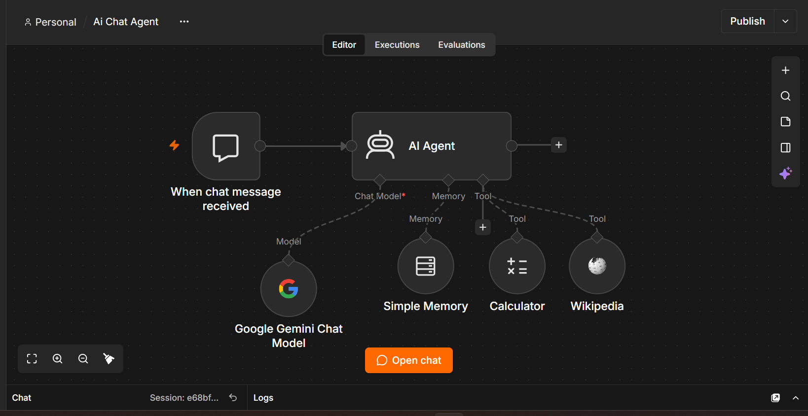

# AI IT Troubleshooting Assistant (n8n)

An AI agent built in n8n that gives step-by-step IT troubleshooting help.

## Features
- Google Gemini chat model
- Chat memory (remembers earlier messages)
- Calculator and Wikipedia tools
- Custom system prompt for simple Windows troubleshooting steps

## Tools used
n8n (self-hosted), Google Gemini API, Node.js

## How to run
1. Install Node.js
2. Run: npx n8n
3. Import the workflow .json file
4. Add your own Gemini API key

## Screenshots
   

